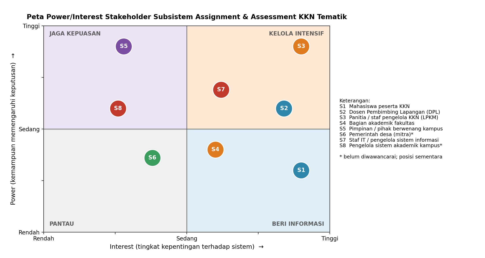

# A2. Stakeholder dan Peta Power/Interest

Penanggung jawab: [ Ashfy Nur Raihana ]

Stakeholder adalah pihak yang menggunakan, mengelola, memengaruhi, atau terdampak oleh subsistem Assignment & Assessment KKN Tematik. Identifikasi dilakukan dengan mengelompokkan pihak terkait ke dalam lima kelompok: **pengguna layanan**, **penyelenggara**, **pimpinan dan pembuat kebijakan**, **mitra eksternal**, serta **pengelola teknis dan sistem terkait**. Setiap stakeholder dinilai berdasarkan *power* (kemampuan memengaruhi keputusan sistem) dan *interest* (seberapa besar sistem memengaruhi pekerjaan atau kepentingannya).

### A2.1 Stakeholder Register

**Tabel 2.2. Stakeholder register subsistem Assignment & Assessment KKN Tematik**

| ID | Stakeholder | Kelompok | Peran dan Kepentingan | Harapan terhadap Sistem | Power | Interest | Strategi Pelibatan |
|---|---|---|---|---|---|---|---|
| S1 | Mahasiswa peserta KKN | Pengguna layanan | Mendaftar, ditempatkan, menjalani bimbingan, menyusun laporan, dan dinilai | Pendaftaran mudah, hasil penempatan jelas, pelaporan sederhana, nilai transparan | Rendah | Tinggi | **Beri informasi**: uji kegunaan dan kumpulkan umpan balik |
| S2 | Dosen Pembimbing Lapangan (DPL) | Pengguna layanan | Membimbing kelompok, meninjau laporan, dan menilai peserta | Memantau kelompok dengan mudah, mencatat bimbingan, menilai dengan rubrik baku | Sedang-Tinggi | Tinggi | **Kelola intensif**: libatkan dalam penyusunan rubrik dan alur bimbingan |
| S3 | Panitia KKN / LP2M | Penyelenggara | Memverifikasi peserta, menetapkan penempatan, merekap nilai, dan melapor ke pimpinan | Data terpusat, penempatan adil dan berbasis aturan, rekap nilai akurat | Tinggi | Tinggi | **Kelola intensif**: pemilik proses bisnis, libatkan dalam setiap keputusan utama |
| S4 | Pimpinan universitas / fakultas | Pimpinan dan pembuat kebijakan | Menetapkan kebijakan KKN dan menerima laporan capaian | Ringkasan capaian, kepatuhan terhadap kebijakan, akuntabilitas | Tinggi | Rendah | **Jaga kepuasan**: laporan berkala yang ringkas |
| S5 | Pemerintah desa (mitra) | Mitra eksternal | Menerima kelompok KKN, mengonfirmasi penempatan, dan memberi penilaian kontribusi | Informasi kelompok dan program yang jelas, antarmuka sederhana untuk menilai | Sedang | Sedang | **Kelola intensif**: akses terbatas dan antarmuka sederhana, konsultasi sebelum rilis |
| S6 | Tim pengelola TI | Pengelola teknis dan sistem terkait | Mengoperasikan, memantau, dan memelihara sistem | Sistem mudah dioperasikan, dipantau, dan dipulihkan saat gangguan | Sedang | Tinggi | **Kelola intensif**: libatkan dalam keputusan teknologi dan operasi |
| S7 | Biro akademik / SIAKAD | Pengelola teknis dan sistem terkait | Menerima nilai akhir untuk dicatat pada sistem akademik | Nilai akhir dalam format yang dapat diimpor tanpa kesalahan | Sedang | Rendah | **Pantau**: sepakati format ekspor, komunikasi seperlunya |

Catatan penilaian: *Power* dan *interest* diberi skala rendah, sedang, dan tinggi berdasarkan analisis awal terhadap peran masing-masing pihak dalam proses KKN.

### A2.2 Peta Power/Interest

Posisi setiap stakeholder pada Tabel 2.2 dipetakan ke dalam empat kuadran menurut kombinasi *power* dan *interest*.

**Gambar 2.2. Peta power/interest stakeholder subsistem Assignment & Assessment KKN Tematik**

### A2.3 Analisis Singkat

| Kuadran | Stakeholder | Implikasi bagi Arsitektur |
|---|---|---|
| Kelola intensif (power tinggi, interest tinggi) | S2 DPL, S3 Panitia, S5 Pemerintah desa, S6 Tim TI | Kebutuhan mereka menjadi pendorong utama: alur penempatan dan penilaian yang berbasis aturan, rubrik terkonfigurasi, antarmuka desa yang sederhana, serta kemudahan operasi dan pemantauan |
| Jaga kepuasan (power tinggi, interest rendah) | S4 Pimpinan | Perlu keluaran berupa rekap capaian dan laporan ringkas; tidak perlu antarmuka operasional |
| Beri informasi (power rendah, interest tinggi) | S1 Mahasiswa | Kebergunaan sangat penting karena jumlah pengguna besar dan kondisi jaringan beragam; antarmuka ringan dan unggahan yang dapat dilanjutkan |
| Pantau (power rendah, interest rendah) | S7 Biro akademik / SIAKAD | Cukup disediakan antarmuka ekspor nilai dengan format terdefinisi |

Dari analisis ini, kebutuhan **panitia, DPL, dan pemerintah desa** paling menentukan fungsi sistem, sedangkan kebutuhan **mahasiswa** paling menentukan kebergunaan dan kinerja pada periode puncak. Pemetaan ini menjadi dasar penentuan pendorong arsitektur pada bagian A3.

<!--
CATATAN PENYESUAIAN (hapus sebelum dikumpulkan):
- Gambar dibuat di folder diagram/ (file: diagram/peta-power-interest.png). Letakkan folder diagram/ sejajar dengan file .md ini
  agar tautan gambar tampil di GitHub. Untuk PDF, sisipkan gambar langsung.
- Nilai power dan interest adalah penilaian awal; sesuaikan dengan hasil wawancara/observasi kelompok.
  Jika posisi diubah, ubah juga koordinat pada gambar (atau minta saya membuat ulang).
- Pada gambar, S2 (power sedang-tinggi) dan S6 (power sedang) diletakkan pada kuadran "kelola intensif";
  S5 berada dekat batas tengah. Jelaskan pada presentasi bila ditanya.
- Register memuat 7 stakeholder dari 5 kelompok (minimal 6 terpenuhi).
-->
<!-- Penanggung jawab: [nama] -->
<!-- Yang diminta: Stakeholder register minimal 6 stakeholder dari lima kelompok, ditambah peta power/interest (gambar dari folder diagram/). -->
<!-- Hapus komentar ini setelah bagian selesai. -->

